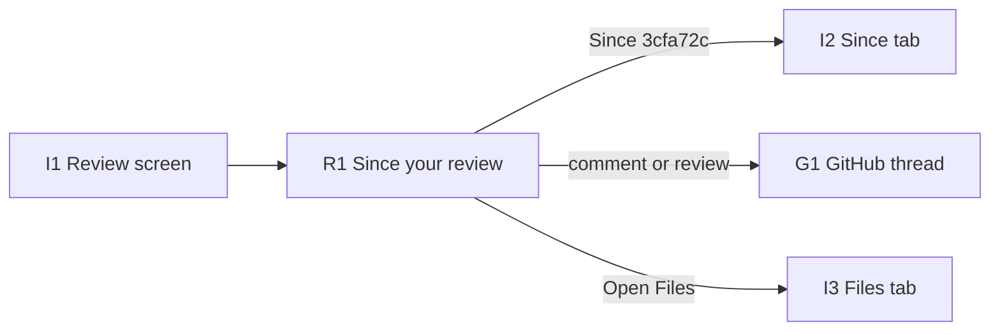

# Recap readability — UI map

Companion to [the spec](./recap-readability.md). One view: the "Since your review" panel on the
review screen of a re-review. The atlas draws every state of it.

Legend: **P1** = this change.

## Navigation

Inbox → a run → Review tab (or the chat's Review pill → Open review). On a re-review the panel
sits at the top of the Summary, above the draft. Nothing in the menu changes.

## Baseline

paseo-inbox main at 995087e (2026-11-26), "Since your review" recap as shipped in #61.

## Flow

## R — Review screen

Views: R1 Since your review.
